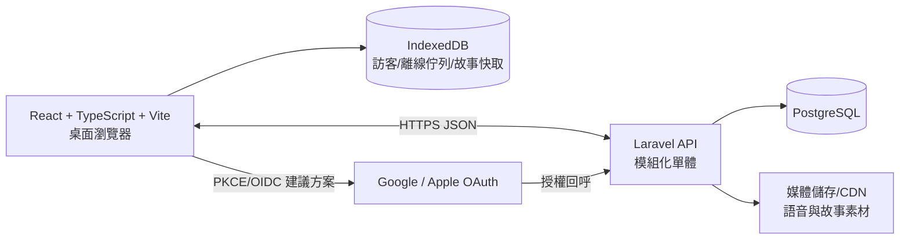

# 系統架構提案

> 狀態：第一階段規劃稿，待產品確認；不是已核准的技術決策。主要依據：`docs/閩南語故事遊戲_Use_Case_規格書_v1.1.md`。規格中第 9 節待確認項目及本文件的「建議」均不得視為已核准需求。規格庫目前未找到 UI 模擬圖；畫面提案先依 UC 與產品規則規劃，待補圖後校正。

## 1. 目標、邊界與明確產品約束

MVP 是桌面優先的瀏覽器遊戲，包含訪客遊玩、Google／Apple 登入、故事播放、收藏、詞語說明、匿名回報、跨裝置保存與離線已載入故事遊玩（UC-01–UC-16）。故事選項只能改變角色回應或少量對話，不可改變主線；重玩使用獨立遊玩工作階段，不得覆蓋主線進度（UC-08、UC-10）。台語語音搭配台語文字與華語字幕，不顯示羅馬字；不錄音、不做 AI 發音評分（UC-08）。語音速度固定為 0.5×、0.75×、1×；台語選項可按鍵試聽，試聽不等於選擇；僅有詞語說明的台詞顯示「看更多」（UC-08、UC-09、UC-16）。登入時訪客資料與帳號資料以整組二選一，不做欄位級合併（UC-02、UC-03）。已載入故事離線可玩（UC-06）。刪除帳號有 30 天等待期（UC-13）。

UC-14 的 MVP 發布角色是工程師協助發布，規格不含完整內容管理後台；這不等於已核准特定內容格式或發布工具。Google 與 Apple 身分驗證是外部依賴（UC-02、UC-15）。

## 2. 建議架構

採用前後端分離的模組化單體：React + TypeScript + Vite SPA、Laravel JSON API、PostgreSQL。以 HTTPS/JSON 溝通，OpenAPI 文件與 API schema 在開發時維護。靜態前端及媒體可由 CDN/物件儲存服務供應；這些部署服務目前只是方案，尚未核准。

### 2.1 前端模組

- `app-shell`: 路由、錯誤邊界、啟動流程（UC-01、UC-04）。
- `auth`: 訪客識別、Google/Apple 登入回呼、登出、帳號狀態（UC-02、UC-12、UC-15）。
- `player-profile`: 訪客/帳號資料來源選擇、帳號刪除申請（UC-03、UC-13）。
- `story-catalog`: 故事/集數瀏覽、解鎖狀態、新內容標記（UC-07、UC-14）。
- `story-player`: 場景狀態機、台詞/字幕、選項、台詞推進、完成摘要、重玩 session（UC-08、UC-10）。
- `audio`: 單一播放通道、倍速、重播/略過、選項試聽的停止與切換（UC-08、UC-09、UC-16）。
- `glossary`: 詞語說明抽屜/對話框、多詞選擇、從說明收藏/回報（UC-16）。
- `favorites`: 收藏/取消、翻譯展開、播放與倍速（UC-09）。
- `reporting`: 匿名問題回報表單（UC-11、UC-16）。
- `settings`: 操作說明、播放偏好、帳號管理（UC-08、UC-12、UC-13）。
- `persistence`: IndexedDB repository、離線故事 cache、outbox、同步狀態與重試（UC-03、UC-05、UC-06）。

### 2.2 後端模組

Laravel 以領域模組隔離路由、驗證、授權、服務及資料存取：Identity/Auth（UC-02、UC-15）、Player Data/Import（UC-03–UC-06、UC-09）、Story Catalog/Unlock（UC-07、UC-08、UC-10、UC-14）、Feedback（UC-11、UC-16）、Account Lifecycle（UC-12、UC-13）。資料庫交易負責資料整組替換、主線進度更新與回報提交；佇列可用於刪除排程及背景任務，但是否採用 queue/排程平台待部署設計確認。

### 2.3 安全與可靠性基線（建議）

- OAuth/OIDC 使用授權碼 + PKCE；伺服器驗證 provider token/nonce/audience，前端不持有 provider client secret（UC-02、UC-15）。Provider 設定、Apple 回呼規則及帳號識別策略需實作前驗證。
- 帳號 API 一律依伺服器驗證的 player ID 授權；不可接受前端指定其他玩家 ID（UC-03–UC-06、UC-09、UC-12、UC-13）。
- 登入、資料匯入/整組替換、刪除申請、回報端點設速率限制；回報需避免收集不必要身分資料（UC-11、UC-13）。實際保留期待決。
- API 寫入採版本/ETag 或等價 optimistic concurrency；過期裝置不得靜默覆蓋新雲端資料（UC-05、UC-06）。
- 只在必要範圍儲存 OAuth subject、帳號資料和回報；日誌不得記錄 token、完整回報個資或敏感 OAuth payload（UC-11、UC-13、UC-15）。
- 故事內容含有版本號與不可變內容版本；用戶端可驗證快取完整性，並只在版本相容時提交進度（UC-06、UC-07、UC-14）。

## 3. 主要資料流

### 3.1 啟動與遊玩

1. 載入 SPA，從 IndexedDB 取得訪客/本機狀態；不存在則建立訪客 profile，進入故事清單（UC-01）。
2. 清單取得可用故事、集數和解鎖資訊；離線時僅呈現快取清單/內容並明確標示可離線範圍（UC-06、UC-07）。
3. 玩家遊玩時以 `content_version + scene_id + node_id` 為穩定位置。選項保存於 session/history，但所有選擇路徑在主要結局匯合（UC-08、UC-10）。
4. 主線操作後更新本機快照；登入玩家送出版本化保存。完成主線集數才觸發解鎖（UC-05、UC-07、UC-08）。重玩寫入 replay session，不改 `main_progress`（UC-10）。

### 3.2 登入與訪客資料選擇

OAuth 成功後取得遊戲帳號。若無本機訪客資料，載入帳號資料；若有訪客資料且帳號已有資料，先展示兩份資料摘要，玩家確認選一整組，再執行原子性匯入或載入。不可做進度/收藏/設定逐欄混合。選擇訪客資料取代帳號資料是高風險破壞性操作，建議加入明確二次確認及可復原備份窗，但需產品確認（UC-02、UC-03）。

### 3.3 離線同步與衝突

本機 IndexedDB 保存已載入故事內容、主線快照、收藏/設定快照及帶 idempotency key 的 outbox。離線只可開始已完整快取且資產可用的故事；API 無法供應時不可宣稱已同步（UC-06）。重連先讀取伺服器版本。若服務端版本等於上次確認版本，提交 outbox；若版本不同且雙方都有變更，依規格顯示設備、時間、故事位置並讓玩家選「保留本機」或「保留雲端」的整組資料。選擇前不覆蓋任一份資料，並建立可審計的衝突解決記錄。訪客資料永遠留在本機，除非依 UC-03 選擇匯入帳號。

需定案「整組資料」涵蓋範圍：建議指主線進度、收藏、設定及必要玩家偏好，不含故事內容快取、回報、重玩歷史、刪除狀態或認證資料；具體範圍列為待決策（UC-03、UC-06）。

## 4. API 草案（非已核准介面）

所有路徑為建議版；需在 API contract review 後定稿。回應錯誤採一致格式（`code`, `message`, `retryable`, `correlation_id`）。敏感寫入採 idempotency key。

| 方法 / 路徑 | 用途與 UC | 權限/重要規則 |
|---|---|---|
| `GET /api/v1/bootstrap` | 啟動、版本與服務能力（UC-01、UC-06） | 可訪客；不回傳其他玩家資料 |
| `GET /api/v1/stories` | 故事目錄/新故事標記（UC-07、UC-14） | 回傳解鎖狀態與非劇透摘要 |
| `GET /api/v1/stories/{story}/episodes/{episode}/content` | 下載故事版本包（UC-07、UC-08、UC-14） | 僅已解鎖可玩內容；回傳版本/hash/cache metadata |
| `GET /api/v1/player-data` | 讀取帳號整組資料與版本（UC-04、UC-05） | 登入；ETag/version |
| `PUT /api/v1/player-data` | 保存整組選定資料（UC-03、UC-05、UC-06、UC-09） | 登入；base version、Idempotency-Key；過期版本回 409 |
| `POST /api/v1/player-data/import-guest` | 將訪客整組資料匯入/取代帳號（UC-03） | 登入；使用者明確選擇、二次確認 token、交易、可稽核 |
| `POST /api/v1/auth/{provider}/exchange` | OAuth 回呼交換/驗證（UC-02、UC-15） | provider allowlist、state/nonce/PKCE 驗證 |
| `POST /api/v1/feedback` | 匿名提交台詞/說明回報（UC-11、UC-16） | 可訪客；不要求 email；rate limit |
| `POST /api/v1/account/deletion-request` | 提出帳號刪除申請（UC-13） | 登入及待確認的身分再驗證；回傳 scheduled date |
| `POST /api/v1/account/deletion-cancel` | 取消等待中的刪除（UC-13） | 登入/重新驗證；等待期限制 |
| `POST /api/v1/auth/logout` | 結束遊戲工作階段（UC-12） | 客戶端先處理未同步選擇 |

故事內容 MVP 發布工作流未定案；上述讀取 API 不代表要建置 CMS。使用者只要求規劃，不在本階段實作 API 或正式遊戲功能。

## 5. 可觀測性與測試策略

記錄同步成功率、409 衝突率、故事包 cache hit、語音播放錯誤、OAuth 成功/取消率、匿名回報送出成功率、刪除流程狀態；採用不含內容正文與可識別 token 的聚合指標（UC-02、UC-05、UC-06、UC-11、UC-13、UC-15）。測試分層：TypeScript unit/component、Laravel feature/API、PostgreSQL integration、Playwright desktop E2E、離線/斷網/重連、OAuth provider sandbox。無障礙、瀏覽器矩陣、效能 SLO 尚未設定，不宣稱符合特定標準（待決策事項見 `docs/decisions.md`）。

## 6. 追溯

完整 UC → UI/模組/API/資料表/驗收案例對照見 `docs/acceptance-matrix.md`；UI 細節見 `docs/screen-spec.md`；欄位與約束見 `docs/data-model.md`；工作切分見 `docs/development-plan.md`。任何新實作需求須標記對應 UC，或明確標示為待決策/工程建議。
