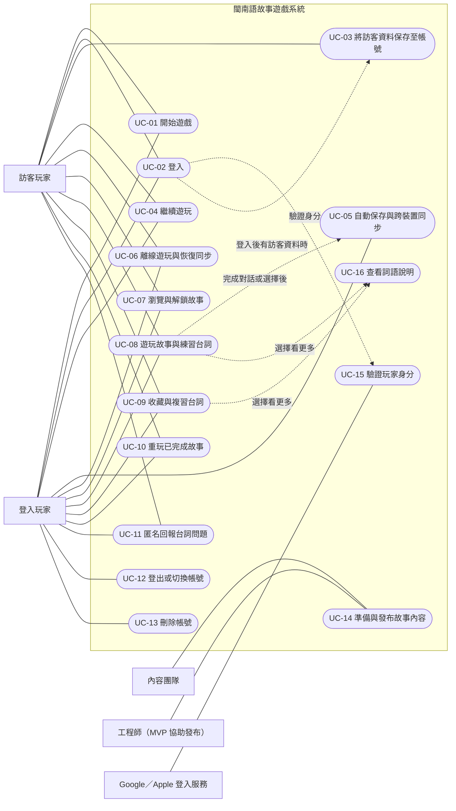

# 閩南語故事遊戲 Use Case 規格書

**版本：** 1.1（需求整理稿）  
**本版變更：** 新增「詞語說明」：俗語、諺語、有典故的詞可按「看更多」查看詳細說明（UC-16）；UC-08 新增本集完成畫面及選項試聽（A7）。  
**產品型態：** 電腦優先的網頁遊戲  
**文件狀態：** 依目前需求對話整理；未定事項列於文件末尾

## 1. 專案概述

本專案是一款以台灣大學生日常互動為背景的閩南語故事遊戲。故事調性輕鬆、搞笑、容易代入，玩家透過聆聽、閱讀和跟讀閩南語台詞接觸語言。

MVP 支援訪客遊玩及 Google／Apple 登入、故事進度保存與同步、故事播放、俗語與諺語的詞語說明、台詞收藏、匿名回報內容問題及帳號管理。主要支援電腦瀏覽器，滑鼠為主要操作方式，並支援常用鍵盤操作。

## 2. 範圍與邊界

### 2.1 MVP 範圍

- 訪客遊玩及 Google／Apple 登入。
- 保存玩家進度、設定與收藏台詞。
- 登入玩家跨裝置同步。
- 已載入故事的離線遊玩及重新連線後同步。
- 故事瀏覽、解鎖、遊玩及重玩。
- 閩南語語音、閩南語台詞與華語字幕。
- 語音重播、播放速度控制、略過及收藏。
- 俗語、諺語及有典故詞語的「看更多」詳細說明。
- 匿名回報台詞用字、翻譯或發音問題。
- 登出、切換帳號及申請刪除帳號。
- 首次遊玩操作說明，可略過並可從設定重看。
- 新故事以遊戲內標記提醒玩家。

### 2.2 不納入 MVP

- 手機最佳化。
- 錄音及發音評分。
- Google／Apple 登入方式連結至同一遊戲帳號。
- 完整內容管理後台。MVP 由工程師協助發布內容。

### 2.3 系統邊界

遊戲系統負責玩家介面、故事播放、遊戲資料保存、故事解鎖、同步及回報資料提交。Google／Apple 負責外部身分驗證。內容團隊負責準備故事、台詞、翻譯和語音；MVP 的內容發布由工程師協助。

## 3. 角色與利害關係人

| 角色 | 說明 |
|---|---|
| 訪客玩家 | 未登入，在目前瀏覽器遊玩，資料保存在該瀏覽器。 |
| 登入玩家 | 透過 Google 或 Apple 登入，資料保存至帳號並可跨裝置同步。 |
| 內容團隊 | 準備故事內容、台詞、華語翻譯、語音及詞語說明。MVP 不直接操作完整後台。 |
| 外部登入服務 | Google 或 Apple，驗證玩家身分並回傳登入結果。 |
| 遊戲系統 | 提供遊戲功能、保存資料、同步進度及處理玩家操作。 |

## 4. Use Case 總覽

| ID | Use Case | 主要角色 |
|---|---|---|
| UC-01 | 開始遊戲 | 訪客玩家、登入玩家 |
| UC-02 | 登入 | 訪客玩家、登入玩家、外部登入服務 |
| UC-03 | 將訪客資料保存至帳號 | 訪客玩家、登入玩家、遊戲系統 |
| UC-04 | 繼續遊玩 | 訪客玩家、登入玩家 |
| UC-05 | 自動保存與跨裝置同步 | 登入玩家 |
| UC-06 | 離線遊玩與恢復同步 | 訪客玩家、登入玩家 |
| UC-07 | 瀏覽與解鎖故事 | 訪客玩家、登入玩家 |
| UC-08 | 遊玩故事與練習台詞 | 訪客玩家、登入玩家 |
| UC-09 | 收藏與複習台詞 | 訪客玩家、登入玩家 |
| UC-10 | 重玩已完成故事 | 訪客玩家、登入玩家 |
| UC-11 | 匿名回報台詞問題 | 訪客玩家、登入玩家 |
| UC-12 | 登出或切換帳號 | 登入玩家 |
| UC-13 | 刪除帳號 | 登入玩家 |
| UC-14 | 準備與發布故事內容 | 內容團隊、工程師 |
| UC-15 | 驗證玩家身分 | 外部登入服務、遊戲系統 |
| UC-16 | 查看詞語說明 | 訪客玩家、登入玩家 |

## 5. 共通規則與資料

### 5.1 共通規則

- 訪客資料保存在目前瀏覽器；清除瀏覽器資料或改用另一瀏覽器時，資料可否復原尚未定義。
- 登入玩家的進度、設定和收藏保存至帳號。
- 故事主線不因選項而分岔；選項可改變角色回應或少量對話。
- 重玩故事不可覆蓋主線進度或影響已解鎖集數。
- 故事畫面顯示閩南語台詞及華語字幕，MVP 不顯示羅馬字。
- 玩家跟讀由本人自行進行，MVP 不錄音、不評分。
- 語音播完後停留在當前台詞，等待玩家操作。
- 含俗語、諺語或典故的台詞可附詞語說明；有說明的台詞才顯示「看更多」按鈕。說明預設收合，不影響不想看的玩家推進故事。
- 支援滑鼠操作，以及 Enter／空白鍵推進、方向鍵切換選項、R 鍵試聽目前選中的選項、Esc 開啟暫停選單。
- 台語選項旁提供試聽按鈕，玩家按下才播放，滑鼠滑過不自動播放。試聽不等於選擇；華語選項不提供試聽。華語台詞與華語選項皆不配音。
- 播放速度提供 0.5×、0.75×、1×。凡是可以播放語音的畫面（對話框、選項、收藏清單）都顯示速度控制。
- 播放中變更速度時，語音從目前位置以新速度繼續，不從頭重播；新速度同時成為之後播放的預設速度，並保存在玩家設定中。

### 5.2 主要資料

| 資料 | 說明 |
|---|---|
| 玩家資料 | 登入識別資料及帳號狀態 |
| 遊戲進度 | 故事、集數、目前位置、完成狀態及解鎖狀態 |
| 設定 | 玩家可調整的遊戲設定；具體欄位尚待確認 |
| 收藏台詞 | 台詞識別資料、收藏時間及關聯故事 |
| 故事內容 | 故事簡介、集數、台詞、選項、華語翻譯及語音 |
| 詞語說明 | 詞語、所屬台詞、類型（俗語／諺語／典故）、字面意思、實際意思、使用情境與語氣、例句；典故來源可選填 |
| 問題回報 | 台詞識別資料、問題類型及玩家補充說明 |
| 同步狀態 | 本機與雲端資料版本、同步狀態及衝突所需資訊 |

## 6. 詳細 Use Case 規格

### UC-01：開始遊戲

**主要角色：** 訪客玩家、登入玩家  
**目標：** 進入遊戲並開始或延續遊玩。  
**觸發條件：** 玩家開啟遊戲首頁。  
**前置條件：** 網頁遊戲可正常載入。  
**後置條件：** 玩家進入遊戲首頁、故事清單或最近遊玩位置。

**基本流程**
1. 系統顯示「訪客遊玩」與「登入」選項。
2. 玩家選擇「訪客遊玩」。
3. 系統載入目前瀏覽器中的訪客資料；若沒有資料，建立新的訪客遊戲資料。
4. 系統帶玩家進入故事清單或遊戲入口。

**替代／例外流程**
- A1：玩家選擇登入。系統執行 UC-02。
- E1：遊戲資料載入失敗。系統顯示錯誤訊息，提供重試或返回首頁。
- E2：訪客資料不存在。系統建立新資料，不阻止玩家遊玩。

### UC-02：登入

**主要角色：** 訪客玩家、登入玩家  
**支援角色：** Google 或 Apple  
**目標：** 驗證玩家身分並載入帳號資料。  
**觸發條件：** 玩家在首頁或遊戲中選擇登入。  
**前置條件：** 玩家可連線至外部登入服務。  
**後置條件：** 玩家登入成功並載入帳號遊戲資料；或取消／登入失敗並返回原畫面。

**基本流程**
1. 系統顯示 Google 與 Apple 登入選項。
2. 玩家選擇一種登入方式。
3. 系統導向所選登入服務。
4. 外部登入服務驗證玩家身分。
5. 外部登入服務將驗證結果回傳遊戲系統。
6. 系統確認登入成功，載入帳號資料。
7. 若目前瀏覽器有訪客資料，系統執行 UC-03。

**替代／例外流程**
- A1：玩家取消登入。系統返回登入前畫面，保留目前訪客資料。
- E1：外部登入驗證失敗。系統顯示登入失敗訊息並提供重試。
- E2：外部登入服務無法使用。系統告知玩家目前無法登入，允許返回訪客遊戲。
- E3：登入成功但帳號資料載入失敗。系統保留登入狀態並提示重試載入；錯誤處理細節待確認。

### UC-03：將訪客資料保存至帳號

**主要角色：** 訪客玩家、登入玩家  
**目標：** 登入後保留訪客的進度、設定與收藏。  
**觸發條件：** 玩家完成登入，且目前瀏覽器有訪客資料。  
**前置條件：** UC-02 登入成功。  
**後置條件：** 系統依玩家選擇使用帳號資料或訪客資料；資料以整組為單位，不部分合併。

**基本流程**
1. 系統檢查登入帳號是否已有遊戲資料。
2. 若帳號沒有遊戲資料，系統將訪客進度、設定及收藏保存至帳號。
3. 系統確認資料保存成功。
4. 玩家以登入狀態繼續遊戲。

**替代流程**
- A1：帳號已有遊戲資料。
  1. 系統詢問玩家要使用帳號資料或訪客資料。
  2. 玩家選擇「使用帳號資料」或「使用訪客資料」。
  3. 系統載入所選的整組資料。
  4. 若選擇訪客資料，系統以訪客資料取代帳號目前使用的遊戲資料。此取代的可復原方式待確認。

**例外流程**
- E1：保存或載入失敗。系統保留可用資料並提示重試；避免在未確認前覆蓋資料。
- E2：玩家尚未選擇資料來源。系統停留在選擇畫面，不開始寫入所選資料。

### UC-04：繼續遊玩

**主要角色：** 訪客玩家、登入玩家  
**目標：** 從最近保存的故事位置繼續遊玩。  
**觸發條件：** 玩家選擇「繼續遊玩」。  
**前置條件：** 玩家有可讀取的遊戲進度。  
**後置條件：** 系統開啟已保存的故事位置。

**基本流程**
1. 玩家選擇「繼續遊玩」。
2. 系統讀取玩家目前可用的遊戲進度。
3. 系統開啟最近保存的故事及台詞位置。
4. 玩家繼續遊玩，後續操作由 UC-08 處理。

**替代／例外流程**
- A1：沒有既有進度。系統引導玩家瀏覽故事，執行 UC-07。
- A2：登入玩家有較新的雲端進度。系統載入最新雲端資料。
- E1：進度資料無法讀取。系統提示重試，或返回故事清單。

### UC-05：自動保存與跨裝置同步

**主要角色：** 登入玩家  
**目標：** 自動保存故事進度，讓玩家在其他裝置接續遊玩。  
**觸發條件：** 登入玩家完成對話、選擇或其他會變更遊戲資料的操作。  
**前置條件：** 玩家已登入，且遊戲資料可寫入。  
**後置條件：** 最新進度保存至帳號；其他裝置可讀取該資料。

**基本流程**
1. 玩家完成一段對話或選擇。
2. 系統記錄目前故事、集數、台詞位置及相關進度。
3. 系統自動保存變更。
4. 玩家在另一台裝置登入。
5. 系統載入帳號最新資料。
6. 玩家從最新保存位置繼續遊玩。

**替代／例外流程**
- A1：目前裝置的遊戲畫面已落後於雲端資料。
  1. 系統偵測到目前畫面使用較舊的資料。
  2. 系統提示玩家重新載入。
  3. 玩家確認後，系統載入最新進度。
- E1：自動保存失敗。系統標示未同步狀態並保留本機變更，連線恢復後重試。失敗提示及重試策略待確認。
- E2：舊畫面嘗試覆蓋較新進度。系統拒絕以舊資料覆蓋雲端最新進度，並要求重新載入或處理資料衝突。

### UC-06：離線遊玩與恢復同步

**主要角色：** 訪客玩家、登入玩家  
**目標：** 網路中斷時繼續遊玩已載入內容，恢復連線後同步。  
**觸發條件：** 玩家遊玩期間網路中斷，或重新連線。  
**前置條件：** 故事內容已載入目前裝置。  
**後置條件：** 離線期間的進度已保存於目前裝置；登入玩家連線後完成同步或進入衝突處理。

**基本流程**
1. 系統偵測到網路中斷。
2. 系統允許玩家繼續遊玩已載入的故事。
3. 系統限制載入新故事。
4. 系統將進度暫存於目前裝置。
5. 系統顯示「進度已暫存在此裝置，連線後會同步」。
6. 網路恢復後，系統在背景同步資料，不中斷遊戲。

**替代／例外流程**
- A1：同步成功。系統更新同步狀態，玩家繼續遊戲。
- A2：本機資料與雲端資料衝突。
  1. 系統顯示兩份資料的裝置、遊玩時間及故事位置。
  2. 玩家選擇保留本機或雲端的整組資料。
  3. 系統依選擇更新資料。
- E1：同步失敗。系統保留本機資料並稍後重試；玩家可繼續遊玩已載入內容。
- E2：離線期間嘗試開啟未載入故事。系統告知需要連線後才能載入。

### UC-07：瀏覽與解鎖故事

**主要角色：** 訪客玩家、登入玩家  
**目標：** 查看故事並進入可遊玩的內容。  
**觸發條件：** 玩家進入故事清單。  
**前置條件：** 故事清單資料可載入。  
**後置條件：** 玩家開始可遊玩的故事，或了解未解鎖故事的條件。

**基本流程**
1. 系統顯示故事清單及故事簡介。
2. 系統標示可遊玩、已完成或未解鎖狀態。
3. 玩家選擇一個可遊玩的故事。
4. 系統載入故事並開始遊玩。

**規則**
- 獨立故事推出後可直接遊玩。
- 長篇連續故事須完成前一集，才能解鎖下一集。
- 未解鎖故事僅顯示主題簡介和解鎖條件，不透露劇情或新角色。
- 新故事以首頁遊戲內標記提醒，不寄送電子郵件通知。

**替代／例外流程**
- A1：玩家選擇未解鎖故事。系統顯示解鎖條件，不開始故事。
- A2：玩家選擇已完成故事。系統提供重玩入口，執行 UC-10。
- E1：故事內容載入失敗。系統提示重試或返回故事清單。

### UC-08：遊玩故事與練習台詞

**主要角色：** 訪客玩家、登入玩家  
**目標：** 透過故事語音、文字和選項接觸閩南語。  
**觸發條件：** 玩家從故事清單開始故事，或從進度位置繼續。  
**前置條件：** 故事已解鎖且內容已載入。  
**後置條件：** 玩家進度依保存規則更新；故事完成時標記完成並更新解鎖條件。

**基本流程**
1. 系統顯示目前角色及閩南語台詞。
2. 系統同時顯示華語字幕並播放閩南語語音。
3. 玩家聆聽台詞並自行跟讀。
4. 玩家可重播語音或調整播放速度；播放中調整時，從目前位置以新速度繼續。
5. 語音播完後，系統停留在目前台詞。
6. 玩家操作後，系統顯示下一段對話或選項。
7. 遇到選項時，系統顯示各選項的台詞及華語意思；台語選項旁顯示試聽按鈕。玩家選擇選項後，系統播放玩家所選台詞，再顯示對應角色回應。
8. 系統保存進度。
9. 故事結束時，系統標記該集完成並更新可解鎖故事。
10. 系統顯示本集完成畫面，列出本次聽到的台語台詞、華語意思及收藏按鈕；有詞語說明的台詞另顯示「看更多」。

**替代流程**
- A1：玩家略過語音。系統停止或跳過目前語音，保留目前台詞畫面。
- A2：玩家快速略過已看過的對話。系統推進至後續對話。
- A3：玩家按 Esc。系統開啟暫停選單。
- A4：玩家首次進入故事。系統顯示簡短操作說明；玩家可略過，之後可從設定重看。
- A5：玩家以鍵盤操作。Enter／空白鍵推進對話；方向鍵切換選項；R 鍵試聽目前選中的選項；Esc 開啟暫停選單。
- A6：目前台詞有詞語說明，玩家選擇「看更多」。執行 UC-16。
- A7：玩家在選擇前試聽選項。
  1. 玩家按下台語選項旁的試聽按鈕，或在選中該選項時按 R 鍵。
  2. 系統以目前播放速度播放該選項語音，並標示播放中的選項。選項畫面同時顯示速度控制；試聽中變更速度時，從目前位置以新速度繼續。
  3. 若另一個選項正在播放，系統先停止它，再播放新的選項；同一時間只播放一個。
  4. 播放結束後，系統停留在選項畫面，不自動選擇；玩家可重複試聽。
  5. 玩家選擇選項時，若試聽仍在播放，系統先停止試聽。

**例外流程**
- E1：語音無法播放。系統保留文字，提示玩家重試或繼續閱讀。錯誤提示設計待確認。
- E2：故事進行中網路中斷。執行 UC-06。
- E3：玩家離開故事畫面。系統依自動保存結果保存已完成的進度。

### UC-09：收藏與複習台詞

**主要角色：** 訪客玩家、登入玩家  
**目標：** 保存感興趣的台詞並於日後複習。  
**觸發條件：** 玩家在故事中收藏台詞，或從選單開啟收藏清單。  
**前置條件：** 台詞及其識別資料可用。  
**後置條件：** 台詞加入或移出收藏清單；登入玩家的收藏同步至帳號。

**基本流程：收藏台詞**
1. 玩家在目前台詞旁選擇「收藏」。
2. 系統將台詞加入收藏清單。
3. 登入玩家的收藏保存至帳號；訪客玩家的收藏保存於目前瀏覽器。
4. 系統顯示已收藏狀態。

**基本流程：複習台詞**
1. 玩家開啟收藏清單。
2. 系統依最近收藏時間由新至舊排序。
3. 系統預設顯示閩南語台詞。
4. 玩家點開一則台詞查看華語翻譯。
5. 玩家可播放語音及調整播放速度。

**替代／例外流程**
- A1：玩家取消收藏。系統將台詞移出收藏清單並更新顯示。
- A2：訪客玩家登入。收藏資料依 UC-03 處理。
- A3：收藏的台詞有詞語說明，玩家選擇「看更多」。執行 UC-16。
- E1：收藏資料保存失敗。系統提示玩家，並保留本機變更以待重試；此行為細節待確認。

### UC-10：重玩已完成故事

**主要角色：** 訪客玩家、登入玩家  
**目標：** 重玩故事並查看不同角色回應。  
**觸發條件：** 玩家從故事清單選擇已完成故事的重玩功能。  
**前置條件：** 該故事已完成。  
**後置條件：** 玩家完成重玩；原主線進度及已解鎖集數維持不變。

**基本流程**
1. 玩家選擇重玩已完成故事。
2. 系統從故事起點開始播放。
3. 玩家選擇不同選項。
4. 系統顯示不同角色回應或少量對話變化。
5. 玩家完成重玩。
6. 系統保留原本主線進度及解鎖狀態。

**規則**
選項只影響角色回應或少量對話，不形成主線分岔。重玩進度與主線進度分開處理。

**例外流程**
- E1：故事內容暫時無法載入。系統提示重試或返回故事清單。

### UC-11：匿名回報台詞問題

**主要角色：** 訪客玩家、登入玩家  
**目標：** 回報台詞用字、翻譯或發音問題。  
**觸發條件：** 玩家在特定台詞上選擇「回報問題」。  
**前置條件：** 系統可取得目前台詞的識別資料。  
**後置條件：** 回報成功提交，或保留內容供玩家重試。

**基本流程**
1. 玩家選擇「回報問題」。
2. 系統顯示問題類型：用字、翻譯、發音；從詞語說明開啟回報時，另提供「說明」類型。
3. 玩家選擇類型並可填寫補充說明。
4. 系統自動附上台詞識別資料。
5. 玩家匿名送出，不需登入或提供聯絡方式。
6. 系統提交回報並顯示確認訊息。

**例外流程**
- E1：送出失敗。系統保留已填寫內容並提供重試。
- E2：玩家取消回報。系統關閉表單，不提交資料。
- E3：補充說明留白。玩家仍可送出回報。

### UC-12：登出或切換帳號

**主要角色：** 登入玩家  
**目標：** 結束目前帳號工作階段，返回首頁或登入其他帳號。  
**觸發條件：** 玩家在設定或帳號選單選擇登出。  
**前置條件：** 玩家已登入。  
**後置條件：** 玩家登出並返回首頁；帳號已同步資料保留。

**基本流程**
1. 玩家選擇登出。
2. 系統檢查是否存在未同步進度。
3. 若無未同步資料，系統登出並返回首頁。
4. 玩家可選擇訪客遊玩或登入其他帳號。

**替代流程**
- A1：存在未同步進度。
  1. 系統提供「等待同步」或「登出並放棄未同步進度」。
  2. 玩家選擇等待時，系統完成同步後登出。
  3. 玩家選擇放棄時，系統丟棄尚未同步的本機進度後登出。
  4. 已同步至帳號的資料保留。

**例外流程**
- E1：等待同步失敗。系統保留玩家登入狀態及未同步資料，提示重試或讓玩家選擇放棄。

### UC-13：刪除帳號

**主要角色：** 登入玩家  
**目標：** 申請刪除遊戲帳號及相關資料。  
**觸發條件：** 玩家在設定中選擇刪除帳號。  
**前置條件：** 玩家已登入並完成必要的身分確認。  
**後置條件：** 申請後進入 30 天等待期；等待期屆滿且未取消時永久刪除帳號及相關遊戲資料。

**基本流程**
1. 玩家選擇「刪除帳號」。
2. 系統說明將刪除故事進度、設定及收藏台詞。
3. 玩家確認刪除申請。
4. 系統將帳號標記為等待刪除，開始 30 天等待期。
5. 系統提供刪除申請狀態及取消方式。
6. 等待期屆滿且玩家未取消時，系統永久刪除帳號及相關遊戲資料。

**替代流程**
- A1：等待期內玩家重新登入。系統詢問玩家「取消刪除」或「繼續刪除」。
- A2：玩家選擇取消刪除。系統恢復帳號及遊戲資料使用。
- A3：玩家選擇繼續刪除。帳號資料暫時不可使用；在 30 天期限內仍可透過重新登入取消。

**例外流程**
- E1：玩家未確認申請。系統不提出刪除申請。
- E2：刪除處理失敗。系統保留申請狀態並提示後續處理方式；通知方式待確認。

### UC-14：準備與發布故事內容

**主要角色：** 內容團隊  
**支援角色：** 工程師  
**目標：** 將新故事或修訂內容提供給玩家。  
**觸發條件：** 內容團隊準備好新故事或內容更新。  
**前置條件：** 故事、台詞、華語翻譯及語音已準備完成。  
**後置條件：** 內容經工程師協助發布後，玩家可在遊戲內看到故事或更新。

**基本流程**
1. 內容團隊準備故事、台詞、華語翻譯及語音，並為俗語、諺語或有典故的詞語撰寫詞語說明。
2. 工程師協助將內容整理為遊戲可使用的格式。
3. 工程師協助發布內容。
4. 系統更新故事清單及解鎖狀態。
5. 若有新故事，系統在首頁顯示遊戲內標記。

**待定事項**
內容審核流程、發布權限、內容格式、回報問題後的修訂與重新發布流程尚未定義。MVP 不包含完整內容管理後台。

### UC-15：驗證玩家身分

**主要角色：** Google 或 Apple 登入服務  
**支援角色：** 遊戲系統  
**目標：** 驗證登入玩家並回傳驗證結果。  
**觸發條件：** 遊戲系統將玩家導向外部登入服務。  
**前置條件：** 玩家已選擇 Google 或 Apple 登入。  
**後置條件：** 驗證結果回傳遊戲系統；玩家完成登入或收到失敗／取消結果。

**基本流程**
1. 外部登入服務接收玩家登入要求。
2. 外部登入服務驗證玩家身分。
3. 外部登入服務將成功結果回傳遊戲系統。
4. 遊戲系統建立或載入對應遊戲帳號。

**替代／例外流程**
- A1：玩家取消驗證。外部登入服務回傳取消結果，遊戲系統返回登入前畫面。
- E1：驗證失敗。外部登入服務回傳失敗結果，遊戲系統提示玩家重試。
- E2：服務無法連線。遊戲系統告知登入暫時不可用，並允許玩家返回訪客遊戲。

### UC-16：查看詞語說明

**主要角色：** 訪客玩家、登入玩家  
**目標：** 了解俗語、諺語或典故的意思與用法，知道什麼時候可以拿來跟朋友說。  
**觸發條件：** 玩家在有詞語說明的台詞旁選擇「看更多」。  
**前置條件：** 該台詞已附詞語說明，且說明內容已載入。  
**後置條件：** 玩家看完說明並回到原畫面；故事位置、語音狀態以外的進度不變。

**可使用的位置**
- 故事中的對話框（UC-08）。
- 本集完成畫面的台詞清單（UC-08 步驟 10）。
- 收藏清單（UC-09）。

**基本流程**
1. 玩家選擇「看更多」。
2. 若語音正在播放，系統暫停語音。
3. 系統顯示詞語說明，內容包含：
   - 詞語及類型（俗語／諺語／典故）
   - 字面意思
   - 實際意思
   - 使用情境與語氣，例如「朋友間互虧，帶點撒嬌，不算罵人」
   - 例句（閩南語台詞＋華語意思），可播放語音
   - 典故來源（有典故時才顯示）
4. 玩家閱讀說明，可播放例句語音。
5. 玩家關閉說明（點「關閉」、點說明外的區域或按 Esc）。
6. 系統回到原畫面，停留在同一句台詞，不自動推進故事。

**替代／例外流程**
- A1：台詞包含多個有說明的詞語。系統先列出詞語，玩家選擇要看的詞語。
- A2：玩家在說明中收藏台詞。系統執行 UC-09 收藏流程。
- E1：說明內容無法載入（例如離線且尚未載入）。系統提示目前無法顯示說明，玩家可關閉並繼續遊戲。
- E2：玩家認為說明有誤。玩家可從說明中開啟回報，執行 UC-11，問題類型新增「說明」。

**規則**
- 只有內容團隊標記為俗語、諺語或典故的詞語提供「看更多」；一般台詞不顯示此按鈕。
- 說明以白話為主，篇幅控制在一個畫面內，避免像在上課。
- 開啟說明不算完成台詞，也不觸發自動保存。

## 7. Use Case Diagram

圖中的虛線表示流程關聯：登入會呼叫外部身分驗證；登入後若有訪客資料，會進入資料保存流程；故事中的對話或選擇完成後會觸發自動保存與同步；在故事或收藏清單中選擇「看更多」會開啟詞語說明。

## 8. 非功能與品質需求

| 項目 | 目前需求 |
|---|---|
| 平台 | MVP 優先支援電腦瀏覽器；手機支援列為後續考量。 |
| 操作 | 滑鼠為主；支援 Enter／空白鍵、方向鍵、R 鍵（試聽選項）及 Esc。 |
| 語言呈現 | 閩南語台詞搭配華語字幕；MVP 不顯示羅馬字。 |
| 詞語說明 | 預設收合，按「看更多」才顯示；一個畫面內讀完，可用 Esc 關閉。 |
| 語音 | 可重播與調整速度（0.5×／0.75×／1×）；播放中調速不從頭重播；播放結束後等待玩家操作。 |
| 進度保存 | 登入玩家每段對話或選擇後自動保存。 |
| 離線能力 | 可遊玩已載入故事；新故事需連線載入。 |
| 同步衝突 | 顯示兩份資料的裝置、時間與故事位置，讓玩家選擇保留整組資料。 |
| 隱私 | 台詞問題回報可匿名，不要求登入或聯絡方式。 |
| 帳號刪除 | 提供 30 天取消等待期。 |
| 可用性 | 首次操作說明可略過，並可從設定再次查看。 |

## 9. 待確認事項

1. **閩南語書寫慣例：**採用哪套用字規則，以及方言詞、異體字的編輯規範。
2. **訪客資料保存：**若玩家清除瀏覽器資料、換瀏覽器或換電腦，是否接受訪客進度無法復原。
3. **登入帳號資料衝突：**玩家選擇訪客資料取代既有帳號資料後，是否提供復原或再次確認。
4. **設定範圍：**哪些設定需要保存及同步。
5. **語音倍速選項：**提供哪些速度，以及不同語音是否都支援。
6. **自動保存提示：**是否顯示保存中、已保存或同步失敗狀態。
7. **同步衝突資料：**除了裝置、時間與故事位置，是否需要顯示其他差異。
8. **刪除帳號流程：**身分確認方式、等待期起訖計算、刪除完成通知方式。
9. **回報資料管理：**回報內容的保存期限、審閱角色及處理狀態是否提供給玩家查看。
10. **內容發布與審核：**故事內容格式、品質檢查及發布流程。
11. **瀏覽器與無障礙需求：**支援的瀏覽器版本、字幕與鍵盤操作的無障礙標準。
12. **效能與可用性目標：**載入時間、同步時間及服務可用性尚未設定。
13. **詞語說明範圍與審核：**哪些詞算俗語、諺語或典故而需要說明；典故來源由誰查證；說明是否也要有語音。

## 10. MVP 驗收摘要

MVP 可視為符合目前需求，需至少做到：

- 玩家可訪客遊玩，或使用 Google／Apple 登入。
- 登入後能保存或選擇訪客資料與帳號資料。
- 玩家能瀏覽故事、依規則解鎖故事並遊玩。
- 故事畫面同時呈現閩南語台詞及華語字幕，語音可重播及調速。
- 玩家可收藏台詞、查看翻譯、播放語音及取消收藏。
- 台語選項可在選擇前用按鈕或 R 鍵試聽；試聽不會選取選項，且同一時間只播放一個。
- 有詞語說明的台詞，在故事中、本集完成畫面及收藏清單都可按「看更多」，查看字面意思、實際意思、使用語氣與例句。
- 登入玩家的進度、設定與收藏可自動保存並跨裝置載入。
- 已載入的故事可離線遊玩；恢復連線後能同步或引導處理衝突。
- 玩家可重玩已完成故事，且不影響主線進度。
- 玩家可匿名回報台詞問題。
- 玩家可登出、切換帳號及申請刪除帳號，刪除申請具 30 天取消等待期。
- 首次操作說明可略過，且可從設定再次查看。

---

本文件依目前需求對話整理。第 9 節列出的事項仍需確認，尤其是閩南語書寫慣例與資料保存衝突規則。
